# Лабораторная работа №3:
## Тема: Маршрутизация, параметры пути и query-параметры

**Студент:** Геграев Ислам Русланович
**Группа:** ПИЖ-б-о-25-2
**Вариант:** 11
**Уровень:** Продвинутый
**Технологии:** Node.js + Express


## Содержание
- [Лабораторная работа №3:](#лабораторная-работа-3)
	- [Тема: Маршрутизация, параметры пути и query-параметры](#тема-маршрутизация-параметры-пути-и-query-параметры)
	- [Содержание](#содержание)
	- [Цель работы](#цель-работы)
	- [Теоретическое обоснование](#теоретическое-обоснование)
	- [Выполнение практического примера](#выполнение-практического-примера)
		- [Команды для запуска](#команды-для-запуска)
	- [Выполнение индивидуального задания](#выполнение-индивидуального-задания)
		- [Скриншоты работы всех эндпоинтов](#скриншоты-работы-всех-эндпоинтов)
	- [Ответы на контрольные вопросы](#ответы-на-контрольные-вопросы)
	- [Вывод:](#вывод)
	- [Рекомендуемые источники](#рекомендуемые-источники)


## Цель работы
Освоить различные способы передачи данных через URL. Научиться строить гибкие маршруты с параметрами пути и query-параметрами, комбинировать их, обрабатывать вложенные ресурсы и валидировать входные данные. Понять разницу между req.params, req.query и req.body.


## Теоретическое обоснование
Маршрутизация (routing) - это механизм сопоставления HTTP-запроса (метод + URL) с кодом-обработчиком на сервере. В Express маршрут описывается как `app.METHOD(PATH, HANDLER)`, где METHOD - HTTP-метод, PATH - путь URL (может содержать параметры), HANDLER - функция, принимающая `req` и `res`. Express проверяет маршруты в порядке объявления, поэтому более специфичные маршруты (например, `/items/stats`) должны идти раньше более общих (`/items/:id`), а wildcard-обработчик 404 - самым последним.

Данные в запросе передаются тремя способами. **Параметры пути** (`req.params`) - часть URL, например `/items/42`; они идентифицируют конкретный ресурс. **Query-параметры** (`req.query`) - пары «ключ=значение» после `?`, например `/items?sort=time&order=desc`; они используются для поиска, фильтрации, сортировки и пагинации. **Тело запроса** (`req.body`) передаётся отдельно от URL в методах POST/PUT/PATCH и используется для создания и обновления ресурсов. Параметры пути и query-параметры всегда приходят строками, поэтому их необходимо приводить к нужному типу.

Вложенные маршруты отражают иерархию ресурсов (`/chefs/1/items/2/steps/3`), позволяя использовать несколько параметров пути одновременно. Поскольку входные данные приходят от клиента, их необходимо валидировать: id - положительное целое число, `page` и `limit` - положительные целые (`limit` ≤ 100), `sort` - из белого списка полей, `order` - только `asc` или `desc`. При неверных параметрах возвращается `400 Bad Request`, при отсутствии ресурса - `404 Not Found`, а необработанные ошибки перехватывает глобальный обработчик и возвращает `500 Internal Server Error`.

| Критерий      | req.params            | req.query         | req.body            |
| ------------- | --------------------- | ----------------- | ------------------- |
| Где в запросе | В пути URL            | После `?`         | В теле запроса      |
| Назначение    | Идентификация ресурса | Фильтрация, поиск | Создание/обновление |
| Тип данных    | Всегда строка         | Всегда строка     | Любой (JSON)        |


## Выполнение практического примера

### Команды для запуска
```bash
mkdir lab3-routing-params
cd lab3-routing-params
npm init -y
npm install express
npm install --save-dev nodemon
node app.js
```

Скрипты в `package.json`:
```json
"scripts": {
  "start": "node app.js",
  "dev": "nodemon app.js"
}
```

**Код сервера (пример с городами):**
```js

const express = require('express');
const app = express();
const port = 3000;

app.use(express.json());

app.use((req, res, next) => {
	console.log(`[${new Date().toISOString()
		} 
    ] ${req.method
		} ${req.url
		}`);
	next();
});

// ДАННЫЕ  
let cities = [
	{
		id: 1, name: 'Москва', population: 13000000, country: 'Россия', area:
			2561
	},
	{
		id: 2, name: 'Санкт-Петербург', population: 5600000, country: 'Россия',
		area: 1439
	},
	{
		id: 3, name: 'Новосибирск', population: 1600000, country: 'Россия',
		area: 505
	},
	{
		id: 4, name: 'Екатеринбург', population: 1500000, country: 'Россия',
		area: 1112
	},
	{
		id: 5, name: 'Казань', population: 1250000, country: 'Россия', area: 425
	}
];


app.get('/cities', (req, res) => {
	res.json({
		count: cities.length, cities
	});
});


app.get('/cities/:id', (req, res) => {
	const id = parseInt(req.params.id);

	if (isNaN(id)) {
		return res.status(400).json({
			error: 'ID должен быть числом'
		});
	}

	const city = cities.find(c => c.id === id);
	if (!city) {
		return res.status(404).json({
			error: 'Город не найден'
		});
	}

	res.json(city);
});


app.get('/cities/:id/area', (req, res) => {
	const id = parseInt(req.params.id);
	const city = cities.find(c => c.id === id);

	if (!city) {
		return res.status(404).json({
			error: 'Город не найден'
		});
	}

	res.json({
		city: city.name,
		area: city.area,
		unit: 'км²'
	});
});

app.get('/countries/:country/cities', (req, res) => {
	const country = req.params.country;
	const filtered = cities.filter(c =>
		c.country.toLowerCase() === country.toLowerCase()
	);

	res.json({
		country,
		count: filtered.length,
		cities: filtered
	});
});


app.get('/cities', (req, res) => {
	let result = [...cities
	];

	// Поиск по названию 
	const search = req.query.search;
	if (search) {
		result = result.filter(c =>
			c.name.toLowerCase().includes(search.toLowerCase())
		);
	}
	// Фильтр по стране 
	const country = req.query.country;
	if (country) {
		result = result.filter(c =>
			c.country.toLowerCase() === country.toLowerCase()
		);
	}
	// Сортировка 
	const sort = req.query.sort;
	const order = req.query.order || 'asc';
	const allowedSortFields = ['id', 'name', 'population', 'area'
	];

	if (sort) {
		if (!allowedSortFields.includes(sort)) {
			return res.status(400).json({
				error: `Поле сортировки должно быть одним из: 
${allowedSortFields.join(', ')
					}`
			});
		}
		if (!['asc', 'desc'
		].includes(order)) {
			return res.status(400).json({
				error: 'Параметр order должен быть asc или desc'
			});
		}

		result.sort((a, b) => {
			if (order === 'desc') {
				return a[sort
				] < b[sort
					] ? 1 : -1;
			}
			return a[sort
			] > b[sort
				] ? 1 : -1;
		});
	}
	// Пагинация 
	const page = parseInt(req.query.page) || 1;
	const limit = parseInt(req.query.limit) || 10;

	if (page < 1) {
		return res.status(400).json({
			error: 'page должен быть >= 1'
		});
	}
	if (limit < 1 || limit > 100) {
		return res.status(400).json({
			error: 'limit должен быть от 1 до 100'
		});
	}

	const start = (page - 1) * limit;
	const end = start + limit;
	const paginated = result.slice(start, end);

	res.json({
		count: result.length,
		page,
		limit,
		totalPages: Math.ceil(result.length / limit),
		cities: paginated
	});
});


app.get('/cities/:id/details', (req, res) => {
	const id = parseInt(req.params.id);
	const city = cities.find(c => c.id === id);

	if (!city) {
		return res.status(404).json({
			error: 'Город не найден'
		});
	} 
	const districts = [
		{
			id: 1, name: 'Центральный', cityId: id
		},
		{
			id: 2, name: 'Северный', cityId: id
		}
	];

	res.json({
		city,
		districts,
		attractions: ['Кремль', 'Парк', 'Музей'
		]
	});
});


app.get('/countries/:country/cities/:cityId', (req, res) => {
	const { country, cityId
	} = req.params;
	const id = parseInt(cityId);

	const city = cities.find(c =>
		c.id === id &&
		c.country.toLowerCase() === country.toLowerCase()
	);

	if (!city) {
		return res.status(404).json({
			error: `Город с ID=${cityId
				} не найден в стране ${country
				}`
		});
	}

	res.json({
		country,
		city
	});
});

// ОБРАБОТКА 404
app.use((req, res) => {
	res.status(404).json({
		error: 'Маршрут не найден'
	});
});

app.listen(port, () => {
	console.log(`Сервер запущен на http: //localhost:${port}`);
});
```


## Выполнение индивидуального задания
**Вариант 11, Продвинутый уровень.**

**Сущность:** Рецепты (recipes): `id`, `title`, `time`, `difficulty`.
**Вложенный ресурс:** шаги рецепта - `/items/:id/steps`.
**Категория:** сложность - `/difficulties/:diff/items`.
**Поля сортировки:** `id`, `title`, `time`. **Поля фильтрации:** `difficulty`, `time`.
**Сущность 2:** шефы (chefs) - `/chefs/:chefId/items`, `/chefs/:chefId/items/:itemId`.
**Статистика:** среднее время приготовления, связь - по сложности.

```js

const express = require('express');
const app = express();
const port = 3000;


app.use(express.json());

app.use((req, res, next) => {
	const startTime = Date.now();

	res.on('finish', () => {
		const duration = Date.now() - startTime;
		console.log(`[${new Date().toISOString()}] ${req.method} ${req.url} ${res.statusCode} ${duration}ms IP: ${req.ip}`);

	});

	next();
})


let recipes = [
	{ id: 1, title: "Борщ", time: 90, difficulty: "medium" },
	{ id: 2, title: "Омлет", time: 10, difficulty: "easy" },
	{ id: 3, title: "Блины", time: 40, difficulty: "easy" },
	{ id: 4, title: "Плов", time: 120, difficulty: "hard" },
	{ id: 5, title: "Салат Цезарь", time: 25, difficulty: "easy" },
	{ id: 6, title: "Лазанья", time: 100, difficulty: "hard" },
	{ id: 7, title: "Сырники", time: 30, difficulty: "medium" }
];


let steps = [
	{ id: 1, recipeId: 1, order: 1, text: "Сварить бульон из мяса" },
	{ id: 2, recipeId: 1, order: 2, text: "Обжарить лук, морковь и свёклу" },
	{ id: 3, recipeId: 1, order: 3, text: "Добавить овощи и капусту в бульон, варить 30 минут" },
	{ id: 4, recipeId: 2, order: 1, text: "Взбить яйца с молоком и солью" },
	{ id: 5, recipeId: 2, order: 2, text: "Вылить на разогретую сковороду и жарить под крышкой" },
	{ id: 6, recipeId: 3, order: 1, text: "Смешать яйца, молоко, муку и сахар" },
	{ id: 7, recipeId: 3, order: 2, text: "Жарить на сковороде с двух сторон" },
	{ id: 8, recipeId: 4, order: 1, text: "Обжарить мясо с луком и морковью" },
	{ id: 9, recipeId: 4, order: 2, text: "Добавить рис и воду, тушить до готовности" },
	{ id: 10, recipeId: 5, order: 1, text: "Нарезать курицу и листья салата" },
	{ id: 11, recipeId: 5, order: 2, text: "Заправить соусом и посыпать сыром" },
	{ id: 12, recipeId: 6, order: 1, text: "Приготовить мясной соус и бешамель" },
	{ id: 13, recipeId: 6, order: 2, text: "Собрать слои и запекать 40 минут" },
	{ id: 14, recipeId: 7, order: 1, text: "Смешать творог, яйцо, сахар и муку" },
	{ id: 15, recipeId: 7, order: 2, text: "Сформировать сырники и обжарить" }
];


app.get('/recipes', (req, res) => {

	let result = [...recipes];

	const search = req.query.search;
	const filter = req.query.filter;
	const sort = req.query.sort;
	const order = req.query.order || 'asc';
	const allowedSortFields = ['id', 'title', 'time'];
	const page = parseInt(req.query.page) || 1;
	const limit = parseInt(req.query.limit) || 10;

	//& Поиск
	if (search) {
		result = result.filter(r => r.title.toLowerCase().includes(search.toLowerCase()));
	}

	//& Фильтрация
	if (filter) {
		const [field, value] = filter.split(':');
		const allowedFilterFields = ['difficulty', 'time'];

		if (!allowedFilterFields.includes(field)) {
			return res.status(400).json({
				error: `Фильтровать можно только по: ${allowedFilterFields.join(', ')}`
			});
		}

		result = result.filter(r => String(r[field]) === value);
	}
	//& Сортировка
	if (sort) {
		if (!allowedSortFields.includes(sort)) {
			return res.status(400).json({
				error: `Сортировать можно только по: ${allowedSortFields.join(', ')}`
			});
		}

		if (order !== 'asc' && order !== 'desc') {
			return res.status(400).json({
				error: 'order должен быть asc или desc'
			});
		}

		result.sort((a, b) => {
			if (a[sort] < b[sort]) {
				return -1;
			}
			if (a[sort] > b[sort]) {
				return 1;
			}
			return 0;
		});

		if (order === 'desc') {
			result.reverse();
		}
	}

	//& Палигнация 
	if (page < 1) {
		return res.status(400).json({ error: 'page должен быть >= 1' });
	}

	if (limit < 1 || limit > 100) {
		return res.status(400).json({ error: 'limit должен быть от 1 до 100' });
	}

	const totalPages = Math.ceil(result.length / limit);
	const start = (page - 1) * limit;
	const items = result.slice(start, start + limit);

	res.json({
		count: result.length,
		page,
		limit,
		totalPages,
		items
	});

});


//& Статистика
app.get('/recipes/stats', (req, res) => {
	const times = recipes.map(r => r.time);
	const total = times.reduce((sum, t) => sum + t, 0);

	res.json({
		count: recipes.length,
		averageTime: Math.round(total / recipes.length),
		minTime: Math.min(...times),
		maxTime: Math.max(...times)
	});
})


app.get('/recipes/:id', (req, res) => {
	const id = parseInt(req.params.id);

	if (isNaN(id)) {
		return res.status(400).json({
			error: 'ID должен быть числом'

		});
	}

	const recipe = recipes.find(r => r.id === id);
	if (!recipe) {
		return res.status(404).json({
			error: 'Рецепт не найден'
		});
	}

	res.json(recipe);
});


app.get('/recipes/:id/steps', (req, res) => {

	const id = parseInt(req.params.id);
	if (isNaN(id)) {
		return res.status(400).json({
			error: 'ID должен быть числом'
		});
	}

	const recipe = recipes.find(r => r.id === id);
	if (!recipe) {
		return res.status(404).json({
			error: 'Рецепт не найден'
		});
	}

	const recipeSteps = steps.filter(s => s.recipeId === id)
	res.json({
		recipe: recipe.title,
		steps: recipeSteps,
		count: recipeSteps.length

	});

});


app.get('/difficulties/:diff/recipes', (req, res) => {
	const difficult = req.params.diff;
	const filtered = recipes.filter(r => r.difficulty.toLowerCase() === difficult.toLowerCase());
	res.json({
		difficult,
		count: filtered.length,
		recipes: filtered

	});

});

app.get('/recipes/:id/steps/:order', (req, res) => {
	const id = parseInt(req.params.id);
	const order = parseInt(req.params.order);

	if (isNaN(id) || isNaN(order)) {
		return res.status(400).json({
			error: 'ID и Order должны быть числами'
		});

	}

	const step = steps.find(s => s.recipeId === id && s.order === order);
	if (!step) {
		return res.status(404).json({
			error: 'Этап не найден'
		});
	}

	res.json(step);
});


app.get('/recipes/:id/steps/:order/next', (req, res) => {
	const id = parseInt(req.params.id);
	const order = parseInt(req.params.order);

	if (isNaN(order) || isNaN(id)) {
		return res.status(400).json({
			error: 'ID и Order должны быть числами'
		});
	}

	const currentStep = steps.find(s => s.recipeId === id && s.order === order);
	if (!currentStep) {
		return res.status(404).json({
			error: "Текущий этап не найден"
		});
	}

	const nextstep = steps.find(s => s.recipeId === id && s.order === order + 1);
	if (!nextstep) {
		return res.status(404).json({
			error: "Следующий этап не найден"
		});
	}

	res.json(nextstep);
});


//& Эндпоинт статистики / recipes / stats.
app.get('recipes/stats', (req, res) => {

	avgTime = recipes.reduce((sum, r) => sum + parseInt(r.avgTime), 0) / recipes.length;
	res.json({ count: recipes.length, averageTime: avgTime.toFixed(1) });
});


//& Валидация сложности 

app.get('/difficulties/abc/recipes', (req, res) => {
	const allowedDifficulties = ['easy', 'medium', 'hard'];

	if (!allowedDifficulties.includes(req.params.difficulty.toLowerCase())) {
		return res.status(400).json({
			error: `Сложность должна быть одной из: ${allowedDifficulties.join(', ')}`
		});
	}
});


// Маршрут / difficulties /: diff / recipes /: id(рецепт внутри категории).
app.get('/difficulties/:diff/recipes/:id', (req, res) => {
	const allowedDifficulties = ['easy', 'medium', 'hard'];
	const diff = req.params.diff.toLowerCase();
	const id = parseInt(req.params.id);

	if (!allowedDifficulties.includes(diff)) {
		return res.status(400).json({
			error: `Сложность должна быть одной из: ${allowedDifficulties.join(', ')}`
		});
	}

	if (isNaN(id)) {
		return res.status(400).json({
			error: 'Id должен быть числом'
		});
	}

	const recipe = recipes.find(r => r.id === id && r.difficulty.toLowerCase() === diff);
	if (!recipe) {
		return res.status(404).json({
			error: `Рецепт с id=${id} в категории "${diff}" не найден`
		});
	}

	res.json(recipe);

});


app.use((req, res) => {
	res.status(404).json({ error: 'Маршрут не найден' });
});

//& Глобальный обработчик ошибок 500.
app.use((err, req, res, next) => {
	console.error(err.stack);
	res.status(500).json({ error: 'Внутренняя ошибка сервера' })
})

app.listen(port, () => {
	console.log(`Сервер запущен на http://localhost:${port}`);
});

```

### Скриншоты работы всех эндпоинтов

**Рецепты и этапы:**

<details>
<summary>1. <code>GET /recipes</code> - список всех рецептов.</summary>

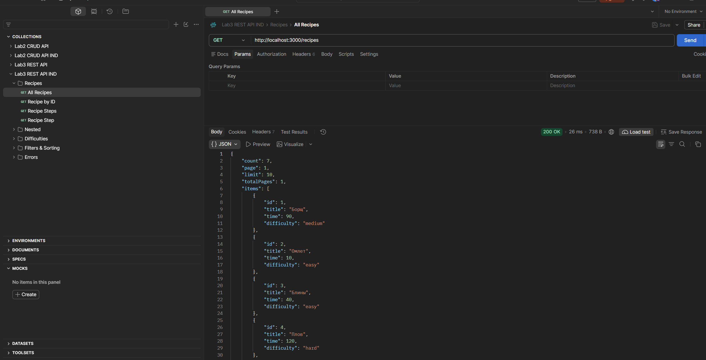

</details>

<details>
<summary>2. <code>GET /recipes/1</code> - один рецепт по id.</summary>


</details>

<details>
<summary>3. <code>GET /recipes/1/steps</code> - все этапы рецепта.</summary>

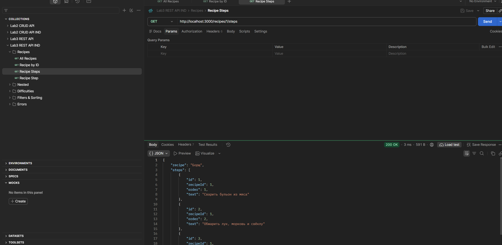

</details>

<details>
<summary>4. <code>GET /recipes/1/steps/1</code> - конкретный этап рецепта.</summary>

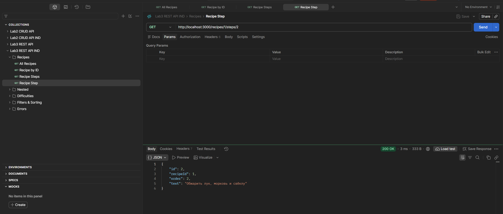

</details>

<details>
<summary>5. <code>GET /recipes/1/steps/1/next</code> - следующий этап после указанного.</summary>

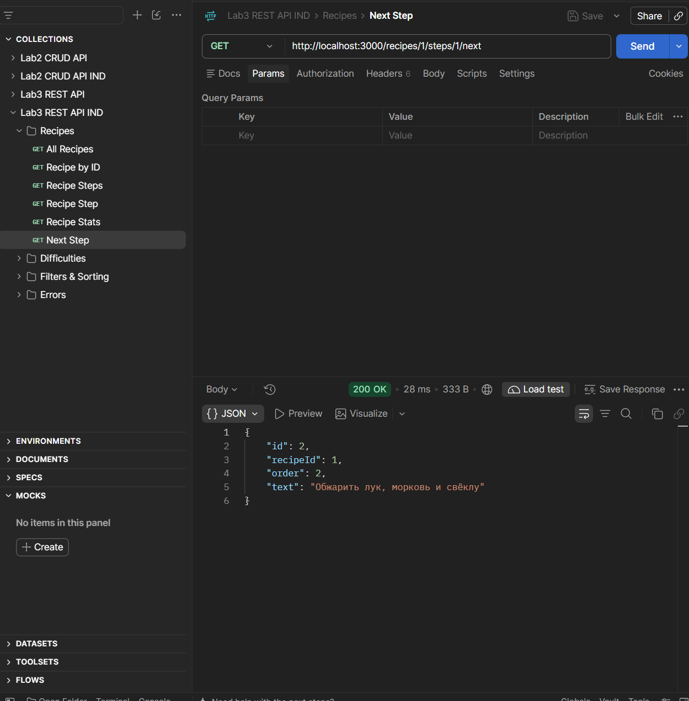

</details>

<details>
<summary>6. <code>GET /recipes/stats</code> - статистика (количество, среднее, min и max время).</summary>

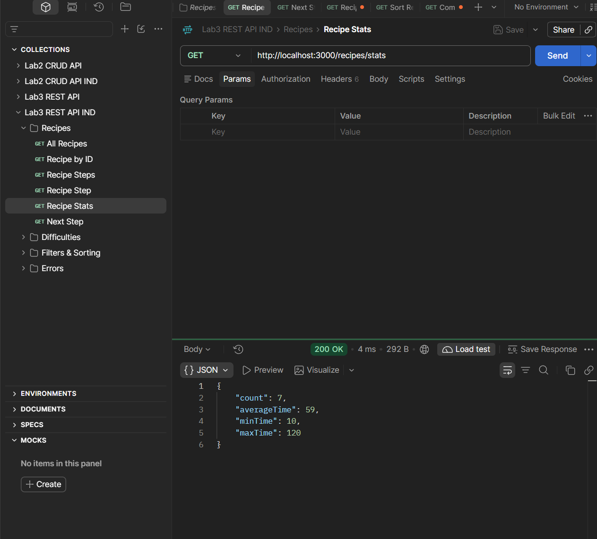

</details>

**Сложности:**

<details>
<summary>7. <code>GET /difficulties/easy/recipes</code> - рецепты категории сложности.</summary>

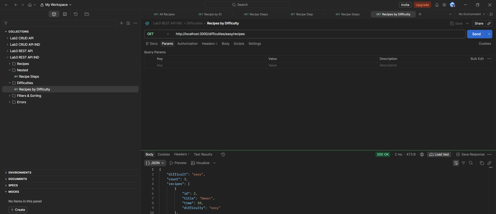

</details>

<details>
<summary>8. <code>GET /difficulties/easy/recipes/2</code> - рецепт внутри категории сложности.</summary>


</details>

**Поиск, фильтрация, сортировка, пагинация:**

<details>
<summary>9. <code>GET /recipes?search=борщ</code> - поиск по названию.</summary>

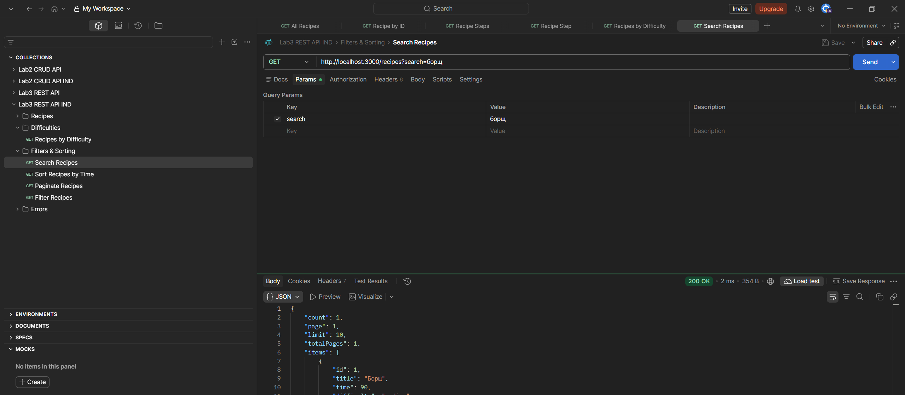

</details>

<details>
<summary>10. <code>GET /recipes?sort=time</code> - сортировка по времени по возрастанию.</summary>

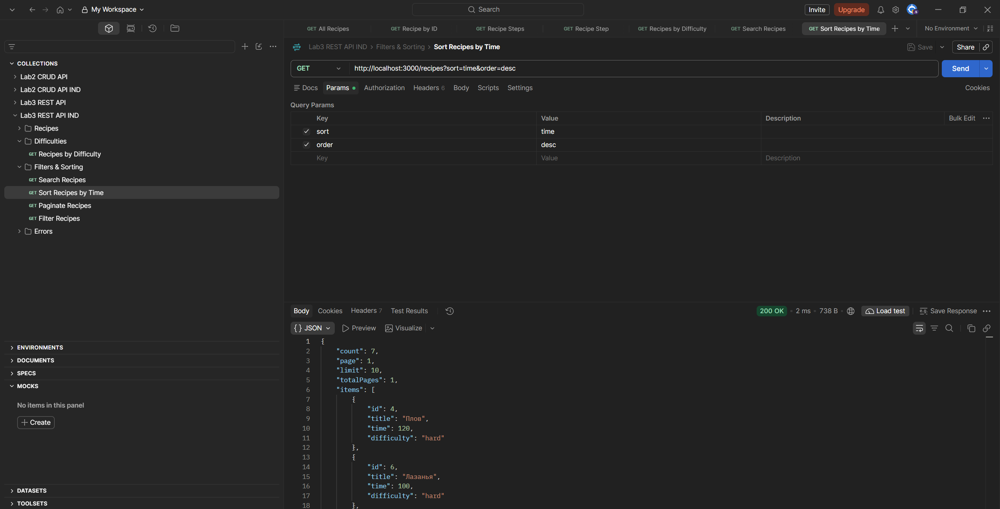

</details>

<details>
<summary>11. <code>GET /recipes?sort=time&order=desc</code> - сортировка по времени по убыванию.</summary>

.png)

</details>

<details>
<summary>12. <code>GET /recipes?page=1&limit=3</code> - пагинация.</summary>

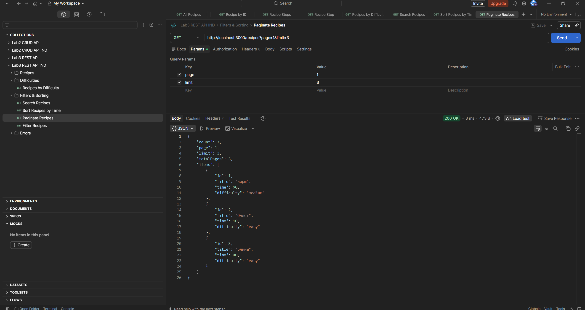

</details>

<details>
<summary>13. <code>GET /recipes?filter=difficulty:easy</code> - фильтрация по полю.</summary>

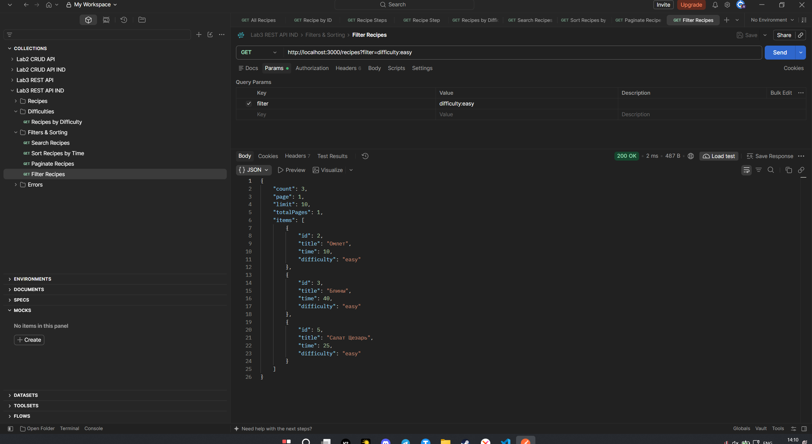

</details>

<details>
<summary>14. <code>GET /recipes?search=с&sort=time&order=asc&page=1&limit=2</code> - комбинация поиска, сортировки и пагинации.</summary>

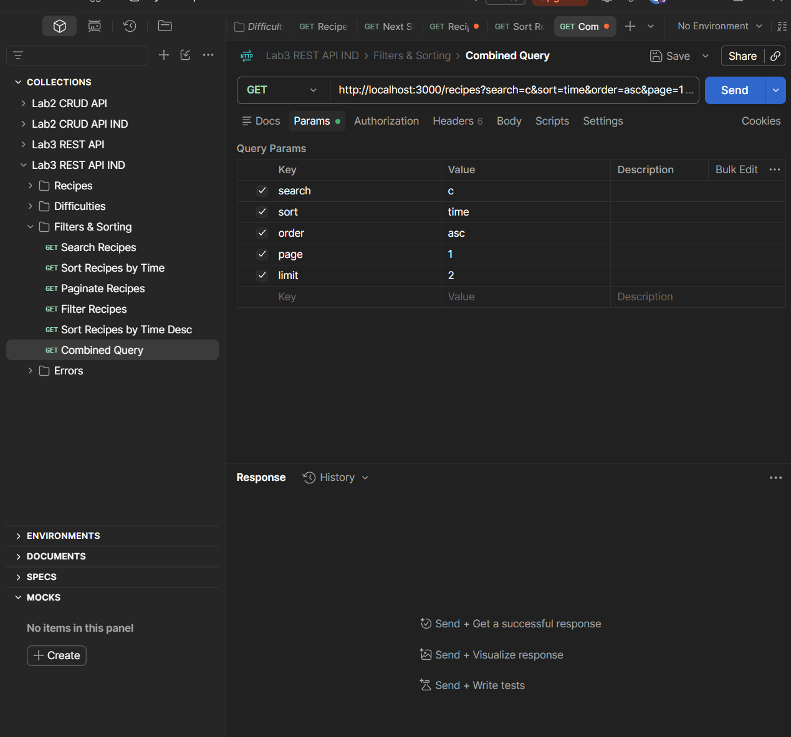

</details>

**Обработка ошибок:**

<details>
<summary>15. <code>GET /recipes/999</code> - 404 при отсутствии рецепта.</summary>

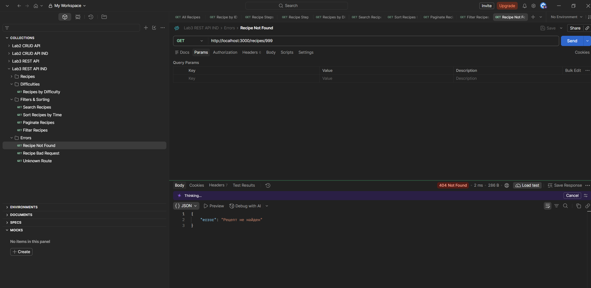

</details>

<details>
<summary>16. <code>GET /recipes/abc</code> - 400 при нечисловом id.</summary>

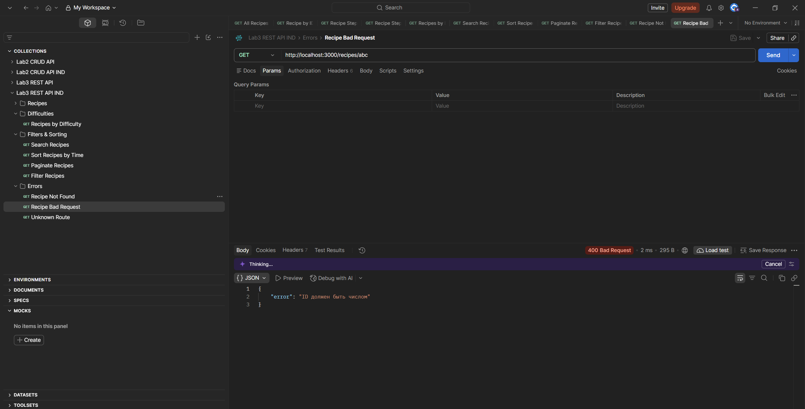

</details>

<details>
<summary>17. <code>GET /anything</code> - 404 при неизвестном маршруте.</summary>

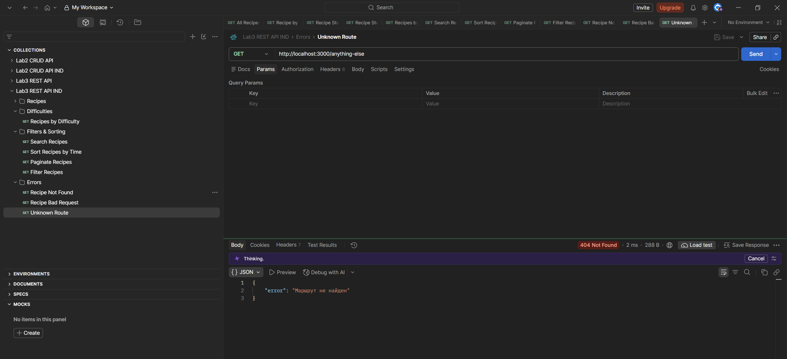

</details>


## Ответы на контрольные вопросы

**1. Что такое маршрутизация? Как она работает в Express/Flask?**
Это сопоставление HTTP-запроса (метод + URL) с функцией-обработчиком. В Express маршрут задаётся как `app.METHOD(PATH, HANDLER)`, во Flask - декоратором `@app.route('/path', methods=['GET'])`.

**2. Чем отличаются req.params, req.query и req.body?**
`req.params` - параметры из пути (`/items/42`), идентифицируют ресурс; `req.query` - пары после `?`, используются для поиска, фильтрации и сортировки; `req.body` - тело запроса (POST/PUT/PATCH) для создания и обновления данных. params и query всегда строки, body может быть любым JSON.

**3. Что произойдёт, если не преобразовать параметр пути в число?**
Параметр останется строкой, и строгое сравнение `c.id === id` никогда не найдёт элемент (число не равно строке), поэтому сервер вернёт 404 даже для существующего ресурса. Поэтому нужен `parseInt` и проверка `isNaN`.

**4. Какой код ответа возвращается, если ресурс не найден, и какой при невалидном параметре?**
Если ресурс не найден - `404 Not Found`, при невалидном параметре (например, `id=abc` или `limit=1000`) - `400 Bad Request`.

**5. Как работает порядок объявления маршрутов в Express? Почему он важен?**
Express проверяет маршруты сверху вниз и выполняет первый подходящий. Поэтому `/items/stats` нужно объявлять до `/items/:id`, иначе слово `stats` будет принято за id. Wildcard-обработчик 404 должен идти последним.

**6. Как реализовать пагинацию с подсчётом общего количества страниц?**
Из query берутся `page` и `limit`, вычисляется `start = (page - 1) * limit`, берётся срез `result.slice(start, start + limit)`, а общее число страниц - `Math.ceil(result.length / limit)`. В ответ включаются `count`, `page`, `limit`, `totalPages`, `items`.

**7. Как валидировать query-параметры и ограничить максимальное значение limit?**
`sort` проверяется по белому списку (`allowedSortFields.includes(sort)`), `order` - только `asc`/`desc`, `page ≥ 1`, `limit` от 1 до 100. При нарушении возвращается 400 с понятным сообщением. Проверка `limit > 100` защищает API от слишком больших выборок.

**8. Как комбинировать параметры пути и query-параметры в одном запросе?**
Параметры пути определяют ресурс, а query уточняют выборку, например `GET /chefs/1/items?sort=time&order=desc&page=1`. В обработчике `req.params.chefId` используется для выбора коллекции, а `req.query` - для фильтрации, сортировки и пагинации.

**9. Как реализовать вложенные маршруты с несколькими уровнями?**
Описывается путь с несколькими параметрами: `app.get('/chefs/:chefId/items/:itemId/steps/:stepId', ...)`. Все параметры доступны через деструктуризацию `req.params`, и каждый из них валидируется отдельно.

**10. Как реализовать глобальный обработчик ошибок и логирование запросов с IP?**
Глобальный обработчик - middleware с четырьмя аргументами `(err, req, res, next)`, объявленный последним; он возвращает клиенту 500. Для логирования в middleware выводятся `req.method`, `req.originalUrl`, время и `req.ip`.


## Вывод:
В результате освоены различные способы передачи данных через URL, построение гибких маршрутов с параметрами пути и query-параметрами, их комбинирование, обработка вложенных ресурсов и валидация входных данных. Понята разница между req.params, req.query и req.body. Реализованы поиск, сортировка, фильтрация и пагинация, wildcard-маршрут для 404, логирование запросов, эндпоинт статистики и глобальный обработчик ошибок 500. Цель достигнута.


## Рекомендуемые источники

1. **Express - Routing** - https://expressjs.com/en/guide/routing.html
2. **Express - Request** - https://expressjs.com/en/4x/api.html#req
3. **Flask - Routing** - https://flask.palletsprojects.com/en/latest/quickstart/#routing
4. **Flask - Request** - https://flask.palletsprojects.com/en/latest/api/#incoming-request-data
5. **HTTP-методы (MDN)** - https://developer.mozilla.org/ru/docs/Web/HTTP/Methods
6. **URL-параметры (MDN)** - https://developer.mozilla.org/ru/docs/Learn/Common_questions/What_is_a_URL
7. **REST API Tutorial** - https://restfulapi.net/
8. **Postman Learning Center** - https://learning.postman.com/